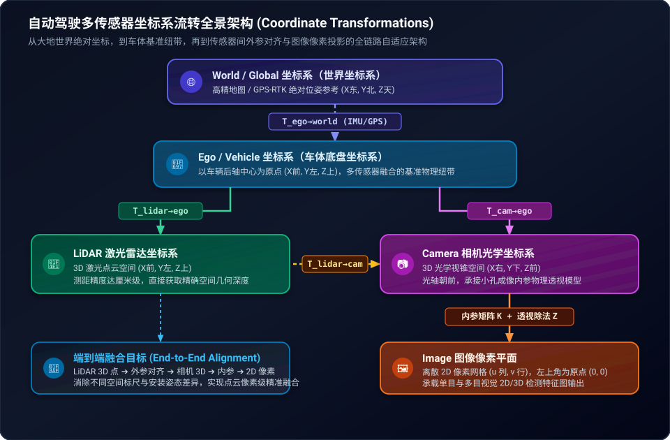
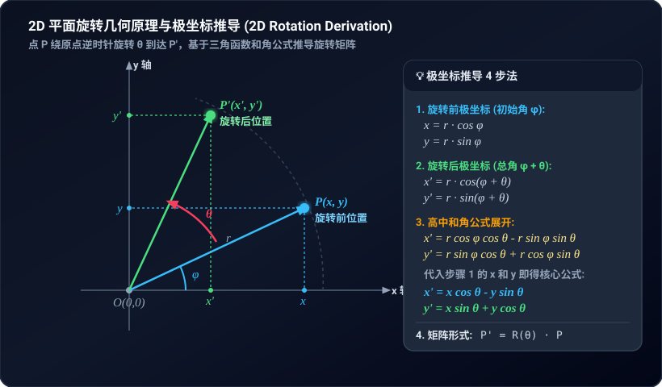
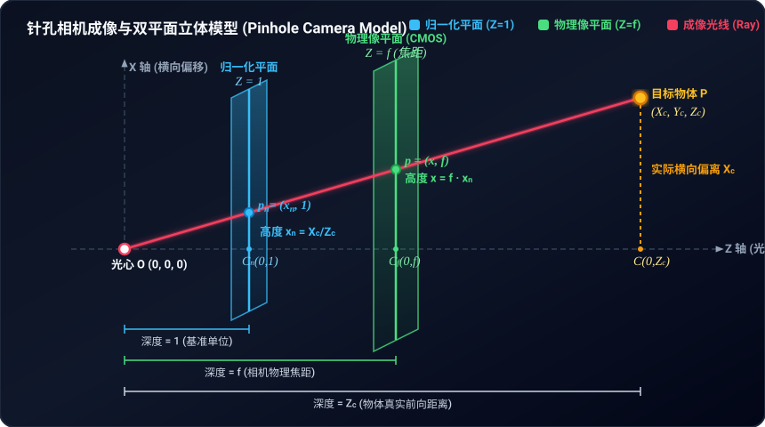
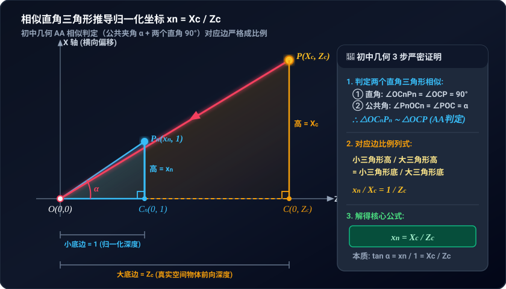
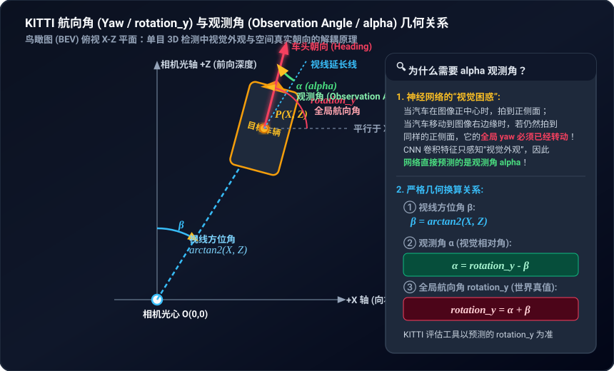

# Stage 2: 刚体变换与投影数学——从零推导

本章目标：彻底搞懂"怎样把 LiDAR 看到的 3D 点，精确地画到相机拍出来的 2D 照片上"。
我们从最基础的坐标系变换（初中平移旋转）出发，一步一步推出工业级公式，最后对照 MMDetection3D 源码验证每一步。

---

## 1. 先搞清楚问题：为什么需要"变换"？

### 1.1 生活类比

想象你在开车，车顶装了一台激光雷达（LiDAR），车前装了一台摄像头（Camera）。

- LiDAR 用**自己**量出来的尺子度量周围物体：它说"前面 10 米、左边 2 米、高 1.5 米有个行人"。
- Camera 也用**自己**的尺子：它说"这个行人在照片第 450 列、第 320 行的位置"。

问题来了：LiDAR 的"前方"和 Camera 的"前方"**根本不是同一个方向**——它俩装在车上不同位置、朝不同方向！  
所以，要想把 LiDAR 的 3D 测量画到 Camera 拍的照片上，就必须做一次"坐标系翻译"，这就是**刚体变换**。

### 1.2 坐标系关系全景图



每个箭头代表一个**变换矩阵**。本章的核心任务就是搞懂这些矩阵是怎么来的、怎么算、怎么连起来用。

### 1.3 核心术语一句话解释

| 术语 | 一句话 | 数学符号 |
|---|---|---|
| **刚体变换** | 只做旋转和平移，不拉伸、不扭曲 | $\mathbf{T} \in SE(3)$，$4\times4$ 矩阵 |
| **外参矩阵** | 告诉你两个传感器之间"位置差多少、朝向差多少" | $\mathbf{T}_{\text{lidar}\to\text{cam}}$ |
| **内参矩阵** | 告诉你相机镜头的"焦距多大、光心在哪" | $\mathbf{K}$，$3\times3$ 矩阵 |
| **透视除法** | 3D 世界的"近大远小"效果，数学上就是除以深度 $Z$ | $u = X/Z$ |

---

## 2. 数学推导（从零开始，逐步到工业级公式）

### 2.1 第一个问题：怎么描述"旋转"？

#### 2.1.1 从 2D 旋转开始（高中数学）



先看最简单的情况：在平面上，把一个点 $(x, y)$ 绕原点**逆时针旋转** $\theta$ 角。

高中学过的旋转公式：

$$x' = x\cos\theta - y\sin\theta$$
$$y' = x\sin\theta + y\cos\theta$$

**怎么记？** 把 $(x,y)$ 想成复数 $x + iy$，乘以 $e^{i\theta} = \cos\theta + i\sin\theta$：

$$(x + iy)(\cos\theta + i\sin\theta) = (x\cos\theta - y\sin\theta) + i(x\sin\theta + y\cos\theta)$$

实部就是 $x'$，虚部就是 $y'$。

写成矩阵形式，就是把两个方程摞在一起：

$$\begin{bmatrix} x' \\ y' \end{bmatrix} = \begin{bmatrix} \cos\theta & -\sin\theta \\ \sin\theta & \cos\theta \end{bmatrix} \begin{bmatrix} x \\ y \end{bmatrix}$$

中间那个 $2\times2$ 矩阵就叫**旋转矩阵**，记为 $\mathbf{R}_{2D}(\theta)$。

#### 2.1.2 旋转矩阵有什么特殊性质？

用上面的 $\mathbf{R}_{2D}$ 验证两个重要性质：

**性质 1：正交性** $\mathbf{R}^T \mathbf{R} = \mathbf{I}$（转置等于逆）

$$\mathbf{R}^T = \begin{bmatrix} \cos\theta & \sin\theta \\ -\sin\theta & \cos\theta \end{bmatrix}$$

$$\mathbf{R}^T \mathbf{R} = \begin{bmatrix} \cos\theta & \sin\theta \\ -\sin\theta & \cos\theta \end{bmatrix} \begin{bmatrix} \cos\theta & -\sin\theta \\ \sin\theta & \cos\theta \end{bmatrix} = \begin{bmatrix} \cos^2\theta + \sin^2\theta & 0 \\ 0 & \cos^2\theta + \sin^2\theta \end{bmatrix} = \begin{bmatrix} 1 & 0 \\ 0 & 1 \end{bmatrix} \checkmark$$

> 👆 关键结论：**旋转矩阵的逆等于它的转置**，即 $\mathbf{R}^{-1} = \mathbf{R}^T$。这个性质后面会反复用到。

**性质 2：行列式恒等于 +1（保手性 / 不做镜像翻转）**

$$\det(\mathbf{R}) = \begin{vmatrix} \cos\theta & -\sin\theta \\ \sin\theta & \cos\theta \end{vmatrix} = \cos\theta \cdot \cos\theta - (-\sin\theta) \cdot \sin\theta = \cos^2\theta + \sin^2\theta = 1 \checkmark$$

很多同学初学线性代数时会非常困惑：**“行列式等于 +1 到底是什么意思？什么是手性？为什么 +1 就是正常旋转，而 -1 就变成镜像翻转了？”**

我们用高中数学和最通俗的生活常识彻底拆解：

---

##### 💡 深入剖析：用高中生也能懂的方式理解“手性”与“行列式”

###### ① 行列式的几何本质：它其实就是“有正负号的面积（或体积）缩放比例”
在高中平面向量中，两个向量 $\vec{u} = \begin{bmatrix} a \\ b \end{bmatrix}$ 和 $\vec{v} = \begin{bmatrix} c \\ d \end{bmatrix}$ 围成的平行四边形面积，公式恰好就是二阶行列式的绝对值：
$$\text{面积} = |\det(\begin{bmatrix} \vec{u} & \vec{v} \end{bmatrix})| = |ad - bc|$$

- **绝对值的大小**：表示这个变换把图形的面积放大了多少倍。因为旋转操作只是把物体转了个身，物体的形状和大小完全没有发生任何改变，面积放大倍数必须是 $1$，所以 $|\det(\mathbf{R})| = 1$。
- **正负号**：代表了**方向（定向/翻转）**！
  - 如果行列式是 **正数（+1）**，说明图形的朝向**没被颠倒**；
  - 如果行列式是 **负数（-1）**，说明图形被**翻了个面（镜像对折）**！

---

###### ② 什么是“手性”（Chirality / Handedness）？
伸出你的**左手**和**右手**：
- 它们大小一样、手指排列顺序一样，但你在真实三维空间里无论怎么扭动手腕、无论怎么旋转你的右手，你的右手能和左手完全重合吗？（让两只手的手心都朝前，大拇指也指向同一侧）
- **永远不可能重合！** 这种“镜像对称但无法通过平移和旋转重合”的几何属性，就叫做**手性**（如同化学里的手性分子、生活中的左右手套）。
- 什么时候你的右手会看起来变成左手？——**照镜子的时候**！镜子里的右手镜像，恰好就是一只左手。
- 放在坐标系中也是一样：
  - 如果一个坐标系的 X、Y、Z 轴满足**右手定则**（右手大拇指为X，食指为Y，中指为Z），它就是**右手系**；
  - 如果把其中一个轴反向（相当于照了镜子），它就变成了**左手系**。
  - **“保持手性”**：意味着变换前是右手系，变换后依然是右手系；变换前左侧的车门，变换后依然在左侧，绝不会被镜像扭曲到右侧去！

---

###### ③ 为什么 $\det = +1$ 是纯旋转，而 $\det = -1$ 包含镜像翻转？

我们看一个最直观的 2D 例子：观察 X 轴基向量 $\vec{i} = \begin{bmatrix} 1 \\ 0 \end{bmatrix}$ 和 Y 轴基向量 $\vec{j} = \begin{bmatrix} 0 \\ 1 \end{bmatrix}$。

原本在平面上，从 X 轴 $\vec{i}$ 走到 Y 轴 $\vec{j}$ 是**逆时针方向**旋转 90°：

1. **情况 A：纯旋转矩阵 $\mathbf{R}(\theta)$**
   $$\begin{bmatrix} \vec{i}' & \vec{j}' \end{bmatrix} = \begin{bmatrix} \cos\theta & -\sin\theta \\ \sin\theta & \cos\theta \end{bmatrix}$$
   计算行列式：
   $$\det(\mathbf{R}) = \cos^2\theta - (-\sin^2\theta) = \cos^2\theta + \sin^2\theta = +1$$
   - **几何效果**：整个坐标系整体转了 $\theta$ 角，从新的 $\vec{i}'$ 扫到新的 $\vec{j}'$ **依然是逆时针**！两根轴的相对先后关系没有任何翻转，图形的“正面”依然是“正面”。

2. **情况 B：镜像翻转矩阵（比如关于 X 轴做镜面反射，把 Y 坐标取负）**
   设变换矩阵为 $\mathbf{M}_{\text{mirror}} = \begin{bmatrix} 1 & 0 \\ 0 & -1 \end{bmatrix}$。
   变换后：$\vec{i}' = \begin{bmatrix} 1 \\ 0 \end{bmatrix}$ 不动，但 $\vec{j}' = \begin{bmatrix} 0 \\ -1 \end{bmatrix}$ 跑到 Y 轴负半轴去了！
   计算行列式：
   $$\det(\mathbf{M}_{\text{mirror}}) = 1 \times (-1) - 0 \times 0 = -1$$
   - **几何效果**：此时从 $\vec{i}'$ 扫到 $\vec{j}'$ 变成了**顺时针**！就像把一张写了字的透明塑料胶片从正面翻到了背面，文字变成了反向的镜面字。这就是 $\det = -1$ 的几何本质！

---

###### ④ 物理旋转的连续性原理（最硬核直观的数学证明）
在物理世界中，一个物体的旋转是**平滑连续发生的**：
1. 当物体完全不动（旋转角 $\theta = 0^\circ$）时，旋转矩阵就是单位矩阵 $\mathbf{I} = \begin{bmatrix} 1 & 0 \\ 0 & 1 \end{bmatrix}$，它的行列式显然是 $\det(\mathbf{I}) = +1$。
2. 随着物体慢慢旋转，矩阵中的三角函数 $\cos\theta, \sin\theta$ 是**连续平滑变化**的，因此行列式的值也必须随着旋转过程连续变化。
3. 但前面根据正交性，我们知道正交矩阵的行列式平方必须为 1：
   $$\det(\mathbf{R}^T \mathbf{R}) = \det(\mathbf{R})^2 = \det(\mathbf{I}) = 1 \implies \det(\mathbf{R}) \text{ 只能是 } +1 \text{ 或 } -1$$
4. **思考**：一个从 $+1$ 开始连续变化的实数，在没有任何断裂的情况下，怎么可能跨过所有中间数值，突然瞬移跳到 $-1$？
   - **绝对不可能！**
   - 只要空间不被撕裂、不照镜子，旋转矩阵的行列式就永远被“锁死”在 $+1$！

---

###### ⑤ 核心总结对比表

| 变换类型 | 行列式 $\det$ | 是否改变手性 | 真实物理世界能否实现？ | 在 3D 目标检测中的后果 |
| :--- | :--- | :--- | :--- | :--- |
| **纯刚体旋转（Proper Rotation）** | **$+1$** | **保持原手性**（右手系仍为右手系） | **可以**（手持刚体自由转动即可达到） | **合法变换**。车的朝向改变，但左右车门、前灯尾灯相对几何结构完全保持原样 |
| **反射/镜像（Improper Rotation）** | **$-1$** | **反转手性**（右手系翻成左手系） | **不可能**（现实中无法把右手转成左手，除非照镜子） | **非法刚体变换**！若误用会把左舵车变成右舵车、点云内外颠倒、导致 3D 框朝向错乱 |

> 📌 **术语小贴士**：在高等几何与李群理论中，满足 $\mathbf{R}^T \mathbf{R} = \mathbf{I}$ 的矩阵集合叫 **$O(3)$（正交群，Orthogonal Group）**；而额外要求 $\det(\mathbf{R}) = +1$ 的旋转矩阵集合叫 **$SO(3)$（特殊正交群，Special Orthogonal Group）**。这里的 **"Special"（特殊）** 指的就是**排除了 $\det = -1$ 的镜像翻转，只保留纯旋转**！


#### 2.1.3 扩展到 3D：绕坐标轴旋转

3D 空间里，绕某个坐标轴旋转时，**那个轴上的坐标不变**，另外两个坐标做 2D 旋转。

**绕 Z 轴旋转 $\theta$**（LiDAR 坐标系的 yaw 轴）：Z 不变，X-Y 平面做 2D 旋转：

$$\mathbf{R}_z(\theta) = \begin{bmatrix} \cos\theta & -\sin\theta & 0 \\ \sin\theta & \cos\theta & 0 \\ 0 & 0 & 1 \end{bmatrix}$$

> 📌 理解方法：第 3 行第 3 列是 1（Z 不变），左上角 $2\times2$ 就是 2D 旋转矩阵。

**绕 Y 轴旋转 $\theta$**（Camera 坐标系的 yaw 轴）：Y 不变，X-Z 平面做旋转：

$$\mathbf{R}_y(\theta) = \begin{bmatrix} \cos\theta & 0 & \sin\theta \\ 0 & 1 & 0 \\ -\sin\theta & 0 & \cos\theta \end{bmatrix}$$

> ⚠️ 注意 $\sin$ 的位置：$R_y$ 中 $\sin$ 出现在 $(3,1)$ 位置是**负号**，$(1,3)$ 位置是**正号**。这和 $R_z$ 相反！原因是右手定则——从 +Y 方向看下去，X→Z 方向才是正方向旋转，而 $R_z$ 中从 +Z 看下去是 X→Y 方向。

**绕 X 轴旋转 $\theta$**：X 不变，Y-Z 平面做旋转：

$$\mathbf{R}_x(\theta) = \begin{bmatrix} 1 & 0 & 0 \\ 0 & \cos\theta & -\sin\theta \\ 0 & \sin\theta & \cos\theta \end{bmatrix}$$

**所有旋转矩阵都满足**：
$$SO(3) = \{ \mathbf{R} \in \mathbb{R}^{3\times 3} \mid \mathbf{R}^T\mathbf{R} = \mathbf{I},\ \det(\mathbf{R}) = +1 \}$$

这个集合叫**特殊正交群**。"特殊"指行列式 = +1（排除镜像），"正交"指 $\mathbf{R}^T\mathbf{R} = \mathbf{I}$。

---

### 2.2 第二个问题：怎么描述"旋转 + 平移"？

#### 2.2.1 朴素写法的麻烦

旋转加平移，最直接的写法是：

$$\mathbf{P}' = \mathbf{R}\mathbf{P} + \mathbf{t}$$

其中 $\mathbf{P}$ 是原始 3D 点坐标，$\mathbf{R}$ 是旋转，$\mathbf{t}$ 是平移。

但这个式子有个大问题：**不方便连乘**。

假设要做两次连续变换：先 $(\mathbf{R}_1, \mathbf{t}_1)$ 再 $(\mathbf{R}_2, \mathbf{t}_2)$：

$$\mathbf{P}'' = \mathbf{R}_2(\mathbf{R}_1\mathbf{P} + \mathbf{t}_1) + \mathbf{t}_2 = \mathbf{R}_2\mathbf{R}_1\mathbf{P} + \mathbf{R}_2\mathbf{t}_1 + \mathbf{t}_2$$

每多一级变换，平移项就多一层嵌套运算，非常麻烦。能不能统一成**纯矩阵乘法**？

#### 2.2.2 齐次坐标：把平移也"装进"矩阵乘法

巧妙的办法：把 3D 点 $\begin{bmatrix} x \\ y \\ z \end{bmatrix}$ 在末尾补一个 1，变成 4 维向量 $\begin{bmatrix} x \\ y \\ z \\ 1 \end{bmatrix}$。

然后构造一个 $4\times4$ 矩阵：

$$\mathbf{T} = \begin{bmatrix} \mathbf{R} & \mathbf{t} \\ \mathbf{0}^T & 1 \end{bmatrix} = \begin{bmatrix} R_{11} & R_{12} & R_{13} & t_x \\ R_{21} & R_{22} & R_{23} & t_y \\ R_{31} & R_{32} & R_{33} & t_z \\ 0 & 0 & 0 & 1 \end{bmatrix}$$

手动展开矩阵乘法验证：

$$\mathbf{T} \begin{bmatrix} x \\ y \\ z \\ 1 \end{bmatrix} = \begin{bmatrix} R_{11}x + R_{12}y + R_{13}z + t_x \\ R_{21}x + R_{22}y + R_{23}z + t_y \\ R_{31}x + R_{32}y + R_{33}z + t_z \\ 0 \cdot x + 0 \cdot y + 0 \cdot z + 1 \end{bmatrix} = \begin{bmatrix} \mathbf{R}\mathbf{P} + \mathbf{t} \\ 1 \end{bmatrix}$$

✅ 前 3 行恰好是 $\mathbf{R}\mathbf{P} + \mathbf{t}$，第 4 行始终是 1。

**这就是齐次坐标的威力**：原本 $\mathbf{R}\mathbf{P} + \mathbf{t}$（乘法 + 加法 混合运算）变成了纯矩阵乘法 $\mathbf{T}\mathbf{P}_h$。

**连乘的好处**：两次连续变换 = 两个矩阵相乘：

$$\mathbf{T}_2 \cdot \mathbf{T}_1 \cdot \mathbf{P}_h = \mathbf{T}_{\text{总}} \cdot \mathbf{P}_h$$

在 GPU 上对 10 万个点做 5 次连续变换，只需先把 5 个 $4\times4$ 矩阵连乘为 1 个（微秒级），再对 10 万个点做 1 次矩阵乘法，而不是 5 次。

> 💡 齐次坐标中**点**和**方向向量**的区别：
>
> | | 末位 | 例子 | 乘以 $\mathbf{T}$ 后 | 受平移影响？ |
> |---|---|---|---|---|
> | **位置点** | $w = 1$ | 一个物体在 $(3, 4, 5)$ | $\mathbf{R}\mathbf{p} + \mathbf{t}$ | ✅ 受影响 |
> | **方向向量** | $w = 0$ | 速度 $(2, 0, 0)$ m/s | $\mathbf{R}\mathbf{v}$ | ❌ 不受影响 |
>
> 理由：$\mathbf{T}\begin{bmatrix}\mathbf{v}\\0\end{bmatrix} = \begin{bmatrix}\mathbf{R}\mathbf{v} + \mathbf{t}\cdot 0\\\end{bmatrix} = \begin{bmatrix}\mathbf{R}\mathbf{v}\\0\end{bmatrix}$。末位是 0 时，$\mathbf{t}$ 被乘以 0 消掉了。
>
> **工程陷阱**：nuScenes 中目标的速度 $(v_x, v_y)$ 做坐标系变换时，齐次末位必须补 0。如果误补 1，速度值会被加上传感器的安装位置偏移，导致跟踪发散！

这种 $4\times4$ 矩阵组成的集合叫做**特殊欧氏群** $SE(3)$：

$$SE(3) = \left\{ \begin{bmatrix} \mathbf{R} & \mathbf{t} \\ \mathbf{0}^T & 1 \end{bmatrix} \in \mathbb{R}^{4\times4} \ \middle|\ \mathbf{R} \in SO(3),\ \mathbf{t} \in \mathbb{R}^3 \right\}$$

---

### 2.3 第三个问题：怎么求逆变换？（逐行推导，不跳步）

> 场景：已知从 LiDAR 到 Camera 的变换 $\mathbf{T}$，即 $\mathbf{P}_{\text{cam}} = \mathbf{R}\mathbf{P}_{\text{lidar}} + \mathbf{t}$。
> 现在反过来，已知相机坐标 $\mathbf{P}_{\text{cam}}$，想求 LiDAR 坐标 $\mathbf{P}_{\text{lidar}}$。

**逐步推导**：

**第 1 步**：写出正向变换：
$$\mathbf{P}_{\text{cam}} = \mathbf{R} \cdot \mathbf{P}_{\text{lidar}} + \mathbf{t} \quad \cdots (1)$$

**第 2 步**：把平移项移到左边：
$$\mathbf{P}_{\text{cam}} - \mathbf{t} = \mathbf{R} \cdot \mathbf{P}_{\text{lidar}} \quad \cdots (2)$$

**第 3 步**：两边同时左乘 $\mathbf{R}$ 的逆矩阵 $\mathbf{R}^{-1}$，就能把左边的 $\mathbf{R}$ "消掉"：
$$\mathbf{R}^{-1}(\mathbf{P}_{\text{cam}} - \mathbf{t}) = \mathbf{R}^{-1}\mathbf{R} \cdot \mathbf{P}_{\text{lidar}} = \mathbf{I} \cdot \mathbf{P}_{\text{lidar}} = \mathbf{P}_{\text{lidar}} \quad \cdots (3)$$

> 上一步用到了 $\mathbf{R}^{-1}\mathbf{R} = \mathbf{I}$（单位阵），这就是"逆矩阵"的定义。

**第 4 步**：利用旋转矩阵的特殊性质 $\mathbf{R}^{-1} = \mathbf{R}^T$：
$$\mathbf{P}_{\text{lidar}} = \mathbf{R}^T(\mathbf{P}_{\text{cam}} - \mathbf{t}) \quad \cdots (4)$$

**第 5 步**：展开括号（矩阵乘法对加法的分配律）：
$$\mathbf{P}_{\text{lidar}} = \mathbf{R}^T \mathbf{P}_{\text{cam}} - \mathbf{R}^T \mathbf{t} \quad \cdots (5)$$

**第 6 步**：写成 $4\times4$ 齐次矩阵形式：

$$\mathbf{T}^{-1} = \begin{bmatrix} \mathbf{R}^T & -\mathbf{R}^T\mathbf{t} \\ \mathbf{0}^T & 1 \end{bmatrix}$$

**第 7 步**：验算 $\mathbf{T}^{-1}\mathbf{T} = \mathbf{I}$（逐块乘法）：

$$\mathbf{T}^{-1}\mathbf{T} = \begin{bmatrix} \mathbf{R}^T & -\mathbf{R}^T\mathbf{t} \\ \mathbf{0}^T & 1 \end{bmatrix} \begin{bmatrix} \mathbf{R} & \mathbf{t} \\ \mathbf{0}^T & 1 \end{bmatrix}$$

分块乘法规则（和普通矩阵乘法一样，只是每个"元素"变成了子矩阵）：

- 左上块：$\mathbf{R}^T \cdot \mathbf{R} + (-\mathbf{R}^T\mathbf{t}) \cdot \mathbf{0}^T = \mathbf{I} + \mathbf{0} = \mathbf{I}$ ✅
- 右上块：$\mathbf{R}^T \cdot \mathbf{t} + (-\mathbf{R}^T\mathbf{t}) \cdot 1 = \mathbf{R}^T\mathbf{t} - \mathbf{R}^T\mathbf{t} = \mathbf{0}$ ✅
- 左下块：$\mathbf{0}^T \cdot \mathbf{R} + 1 \cdot \mathbf{0}^T = \mathbf{0}^T$ ✅
- 右下块：$\mathbf{0}^T \cdot \mathbf{t} + 1 \cdot 1 = 1$ ✅

所以 $\mathbf{T}^{-1}\mathbf{T} = \begin{bmatrix} \mathbf{I} & \mathbf{0} \\ \mathbf{0}^T & 1 \end{bmatrix} = \mathbf{I}_{4\times4}$，验算通过。🎉

> ⚠️ **初学者最常犯的错误**：把逆矩阵的平移部分写成 $-\mathbf{t}$ 而不是 $-\mathbf{R}^T\mathbf{t}$。
>
> **直觉理解为什么要乘 $\mathbf{R}^T$**：平移向量 $\mathbf{t}$ 本身是在**目标坐标系**（Camera 系）的基底下表达的。要回到**源坐标系**（LiDAR 系），光"倒着走" $-\mathbf{t}$ 不够——这个"方向"还是 Camera 系的方向，需要用 $\mathbf{R}^T$ 把它转回 LiDAR 系的方向。

> 🔢 **具体数字例子**：  
> 设旋转 $\mathbf{R} = \begin{bmatrix} 0 & -1 & 0 \\ 1 & 0 & 0 \\ 0 & 0 & 1 \end{bmatrix}$（绕 Z 轴转 90°），平移 $\mathbf{t} = \begin{bmatrix} 3 \\ 0 \\ 0 \end{bmatrix}$。
>
> - 错误的逆平移：$-\mathbf{t} = \begin{bmatrix} -3 \\ 0 \\ 0 \end{bmatrix}$
> - 正确的逆平移：$-\mathbf{R}^T\mathbf{t} = -\begin{bmatrix} 0 & 1 & 0 \\ -1 & 0 & 0 \\ 0 & 0 & 1 \end{bmatrix}\begin{bmatrix} 3 \\ 0 \\ 0 \end{bmatrix} = -\begin{bmatrix} 0 \\ -3 \\ 0 \end{bmatrix} = \begin{bmatrix} 0 \\ 3 \\ 0 \end{bmatrix}$
>
> 可以看到，$-\mathbf{t}$ 和 $-\mathbf{R}^T\mathbf{t}$ 的结果**完全不同**！

---

### 2.4 第四个问题：怎么把 3D 点"拍"成 2D 照片？（针孔相机模型）

这是整个多传感器投影链路中最关键的核心跨越：**把相机 3D 空间坐标 $(X_c, Y_c, Z_c)$（以米为单位）投影为照片上的 2D 像素坐标 $(u, v)$（以像素格子为单位）**。

#### 2.4.1 生活直觉：近大远小与降维投影

现实物理世界是三维的（长、宽、高），而照片只是二维平面。从 3D 变 2D，必然会**丢失一个维度（深度 $Z$）**。

你在日常生活中站在铁轨中央往前看，两条铁轨明明平行，但远处看起来却逐渐收拢为一个点。这就是所谓的“透视现象”。
在数学上，“近大远小”的本质极其朴素：**物体在画面中的横向偏离，被物体的距离（深度 $Z_c$）除了一下！** 距离越远，$Z_c$ 越大，除出来的结果就越小。

#### 2.4.2 全局架构：针孔相机与“双平面模型”



<div align="center">
  <span style="color:#f43f5e; font-weight:bold;">🔴 红色实线：成像光线 (Ray)</span> &nbsp;|&nbsp; 
  <span style="color:#0284c7; font-weight:bold;">🔵 蓝色线条：归一化平面 (Z = 1)</span> &nbsp;|&nbsp; 
  <span style="color:#16a34a; font-weight:bold;">🟢 绿色线条：物理像平面 (Z = f)</span> &nbsp;|&nbsp; 
  <span style="color:#d97706; font-weight:bold;">🟡 橙色虚线：真实物体 (Z = Zc)</span>
</div>

在正式推导前，先看清相机成像的“三级跳路线图”：

1. **真实三维物体**：空间中有一个发光点 $P(X_c, Y_c, Z_c)$，它发出的一束光线笔直射向相机光心 $O$。
2. **第一跳：穿过“归一化平面”**（🔵 蓝色，距离 $Z = 1$ 米）
   - 这是一个虚拟的纯数学基准面。光线穿过它留下的交点记为 $p_n(x_n, y_n, 1)$。
   - **核心使命**：把“三维空间几何”与“相机具体硬件”彻底解耦。得到无量纲的角度信息 $(x_n, y_n)$。
3. **第二跳：打在“物理像平面”**（🟢 绿色，距离 $Z = f$ 毫米）
   - 这是真实相机感光芯片（CMOS/胶卷）的安装位置，$f$ 是镜头焦距。
   - **核心使命**：光线在芯片上汇聚成物理光斑 $p(x, y)$，其坐标单位是**毫米**。
4. **第三跳：离散化为“屏幕像素”**（图像平面，行与列）
   - 感光芯片由密密麻麻的感光小格子（像素）拼成。
   - **核心使命**：将毫米尺寸转换为像素网格格子号 $(u, v)$。

下面我们沿着这三级跳，一步一步从零严密推导。

---

#### 2.4.3 步骤一：相似三角形推导归一化坐标 $(x_n, y_n)$



##### 1. 为什么定义 $x_n$？
- **字母含义**：$n$ 是英文 **normalized**（归一化）的简写。$x_n$ 代表“归一化平面上的横坐标”。
- **定义方式**：在相机光心正前方刚好 $1$ 个单位深度（$Z = 1$）处立一面虚拟参考屏幕。物体 $P$ 射向光心 $O$ 的光线穿透该屏幕的交点，就被定义为 $(x_n, y_n, 1)$。

##### 2. 相似三角形证明（初中平面几何）
观察由横向偏移（X 轴）与前向深度（Z 轴）构成的 **X-Z 截面**（从上往下俯视）：
- **大直角三角形 $\triangle OCP$**：
  - 顶点 $O(0, 0)$ 是光心，点 $P(X_c, Z_c)$ 是物体；
  - 垂足 $C(0, Z_c)$ 在光轴上，底边 $OC = Z_c$（物体深度），高 $CP = X_c$（物体横向偏离）。
- **小直角三角形 $\triangle OC_n P_n$**：
  - 垂足 $C_n(0, 1)$ 在归一化屏幕上，底边 $OC_n = 1$，高 $C_n P_n = x_n$。

**证明相似**：
1. 两个三角形均垂直于光轴：$\angle OC_n P_n = \angle OCP = 90^\circ$；
2. 两个三角形共用同一个顶点角：$\angle P_n OC_n = \angle POC = \alpha$（光线与光轴的夹角）；
3. 由“两角对应相等”，判定 **$\triangle OC_n P_n \sim \triangle OCP$**。

**对应边成比例**：
$$\frac{\text{小三角形的高}}{\text{大三角形的高}} = \frac{\text{小三角形的底}}{\text{大三角形的底}} \implies \frac{x_n}{X_c} = \frac{1}{Z_c}$$

两边同乘 $X_c$，得到最核心的几何公式：
$$\boxed{x_n = \frac{X_c}{Z_c}}$$

同理，在纵向高度截面（Y-Z 平面）上完全对称：
$$\boxed{y_n = \frac{Y_c}{Z_c}}$$

> 📌 **几何本质**：
> $\tan\alpha = \frac{\text{对边}}{\text{邻边}} = \frac{X_c}{Z_c} = \frac{x_n}{1} = x_n$。
> 归一化坐标 $(x_n, y_n)$ 本质上就是**光线偏离相机光轴的角度正切值**！它是一个无量纲的纯数字。

---

#### 2.4.4 步骤二：从归一化坐标到屏幕像素坐标 $(u, v)$

光线穿过归一化平面后，接下来要打在相机内部的 CMOS 感光芯片上，并转换成屏幕上的像素点 $(u, v)$。这一过程包含两步换算：

##### ① 镜头焦距缩放（无量纲 $\to$ 毫米物理尺寸）
相机镜头把感光芯片固定在后方物理焦距 $f$ 处（对称到前方即 $Z = f$）。
根据相似三角形比例：
$$\frac{\text{像平面尺寸 } x}{\text{像平面距离 } f} = \frac{\text{归一化尺寸 } x_n}{\text{归一化距离 } 1} \implies x = f \cdot x_n = f \frac{X_c}{Z_c} \quad \text{（单位：mm）}$$
此时 $x$ 是感光芯片上物理光斑的真实毫米宽度。

##### ② 像元尺寸转换与原点平移（毫米 $\to$ 像素格子 $(u, v)$）
1. **像元密度换算**：
   CMOS 芯片由一个个微小的感光像元排列而成。设单个像素的物理宽度为 $d_x$（毫米/像素），物理高度为 $d_y$（毫米/像素）。
   则芯片上的物理尺寸 $x$ 对应的像素格子数量为：
   $$\frac{x}{d_x} = \frac{f \cdot x_n}{d_x} = \left(\frac{f}{d_x}\right) x_n$$
   我们把 $\frac{f}{d_x}$ 整体打包定义为 **$f_x$（水平等效像素焦距，单位：pixel）**，同理 $f_y = \frac{f}{d_y}$。
   > 📌 **为什么区分 $f_x$ 和 $f_y$？** 现代 CMOS 的感光像元大多接近正方形（$d_x \approx d_y$），因此 $f_x \approx f_y$。但由于制造工艺公差或非正方形像素的存在，工业级标定一律将二者区分。

2. **主点偏移（坐标原点平移）**：
   - 相机光轴穿过 CMOS 的正中心附近，叫作**主点（Principal Point）**。
   - 但是，图像像素坐标系 $(u, v)$ 的原点 $(0, 0)$ 规定在图像的**左上角**（第 0 行第 0 列），$u$ 轴向右，$v$ 轴向下。
   - 设主点在像素坐标系下的位置为 $(c_x, c_y)$（通常大约是图像宽度和高度的一半，如 $1280\times720$ 图像的主点约为 $(640, 360)$）。
   - 因此，必须把中心位置平移到左上角参考系中：

$$\boxed{u = f_x \cdot x_n + c_x = f_x \frac{X_c}{Z_c} + c_x}$$
$$\boxed{v = f_y \cdot y_n + c_y = f_y \frac{Y_c}{Z_c} + c_y}$$

$(u, v)$ 就是最终显示在电脑屏幕上的**像素坐标（第 $u$ 列，第 $v$ 行）**！

> 🔢 **生活数值小例子（感受“近大远小”）**：
> 设相机参数为：$f_x = 1000\text{ px}$，主点 $c_x = 640\text{ px}$（图像宽度 1280）。
> - **情况 A（较近）**：一辆车在右前方，横向偏离 $X_c = 2\text{ m}$，距离 $Z_c = 10\text{ m}$：
>   $$u = 1000 \times \frac{2}{10} + 640 = 200 + 640 = 840\text{ px}$$
> - **情况 B（较远）**：这辆车开到了远处 $Z_c = 40\text{ m}$，横向偏离依然是 $X_c = 2\text{ m}$：
>   $$u = 1000 \times \frac{2}{40} + 640 = 50 + 640 = 690\text{ px}$$
> 
> 可以看到，随着距离 $Z_c$ 从 10 米增大到 40 米，$u$ 坐标从 840 急剧缩回到 690（越来越靠近图像中央主点 640）——这就是“近大远小”在数学上的精准体现。

---

#### 2.4.5 步骤三：写成矩阵形式（内参矩阵 $\mathbf{K}$ 与透视除法）

现在我们有了单点计算公式，但在自动驾驶中，激光雷达每秒产生 10 万个点云，必须用 GPU 进行并行矩阵乘法。

**面临的核心难题**：
矩阵乘法是**线性运算**（只有乘常数和加法），但公式 $u = f_x \frac{X_c}{Z_c} + c_x$ 中包含了一个非线性的**除法（除以 $Z_c$）**！线性代数无法直接用一个矩阵表示除以未知数 $Z_c$。

**数学家的破局神技**：
先把等式两边同时乘以分母 $Z_c$：
$$u \cdot Z_c = f_x \cdot X_c + c_x \cdot Z_c$$
$$v \cdot Z_c = f_y \cdot Y_c + c_y \cdot Z_c$$
$$1 \cdot Z_c = 0 \cdot X_c + 0 \cdot Y_c + 1 \cdot Z_c$$

将三个方程整整齐齐地写成矩阵与向量相乘的形式：

$$\begin{bmatrix} u \cdot Z_c \\ v \cdot Z_c \\ Z_c \end{bmatrix} = \begin{bmatrix} f_x & 0 & c_x \\ 0 & f_y & c_y \\ 0 & 0 & 1 \end{bmatrix} \begin{bmatrix} X_c \\ Y_c \\ Z_c \end{bmatrix}$$

中间这个优雅的 $3\times3$ 矩阵，就是名震天下的**相机内参矩阵（Camera Intrinsic Matrix）**，通常记为 $\mathbf{K}$：

$$\mathbf{K} = \begin{bmatrix} f_x & 0 & c_x \\ 0 & f_y & c_y \\ 0 & 0 & 1 \end{bmatrix}$$

##### 什么是“透视除法”？
矩阵乘法只能算出左侧的 $[u \cdot Z_c,\ v \cdot Z_c,\ Z_c]^T$。要得到最终的屏幕像素 $(u, v)$，只需执行最后一步：**将整个向量除以它的第 3 个分量（深度 $Z_c$）**：
$$\begin{bmatrix} u \cdot Z_c \\ v \cdot Z_c \\ Z_c \end{bmatrix} \xrightarrow{\text{除以第3分量 } Z_c} \begin{bmatrix} u \\ v \\ 1 \end{bmatrix}$$
这一步就叫作**透视除法（Perspective Division）**。

> 💡 **架构设计之美**：
> 为什么不直接算，非要“先乘以 $Z_c$ 拼成矩阵、再整体除以 $Z_c$”？
> 因为这样巧妙地把**所有线性变换（缩放、平移）全部打包交给了内参矩阵 $\mathbf{K}$ 进行 GPU 硬件矩阵加速**，把唯一的非线性除法隔离到了最后一步。

---

#### 2.4.6 步骤四：全链路串联（从世界坐标直达像素平面）

在实际自动驾驶工程中，3D 点最初并不在相机坐标系下，而是位于世界坐标系或激光雷达坐标系。
因此，完整的投影流水线是两步接力：
1. **外参刚体变换 $[\mathbf{R} \mid \mathbf{t}]$**：把世界坐标系点 $\mathbf{P}_w$ 搬移到相机光学坐标系 $\mathbf{P}_c$；
2. **内参投影 $\mathbf{K}$ 与透视除法**：把相机坐标系点 $\mathbf{P}_c$ 拍成相片上的像素 $\mathbf{p}_{\text{pixel}}$。

写成统一的齐次矩阵相乘形式：

$$Z_c \begin{bmatrix} u \\ v \\ 1 \end{bmatrix} = \underbrace{\mathbf{K}}_{3\times3} \cdot \underbrace{[\mathbf{R} \mid \mathbf{t}]}_{3\times4} \cdot \underbrace{\begin{bmatrix} X_w \\ Y_w \\ Z_w \\ 1 \end{bmatrix}}_{\text{齐次世界坐标}} = \underbrace{\mathbf{P}}_{3\times4} \cdot \begin{bmatrix} X_w \\ Y_w \\ Z_w \\ 1 \end{bmatrix}$$

其中，乘积矩阵 $\mathbf{P} = \mathbf{K}[\mathbf{R} \mid \mathbf{t}]$ 称为 **$3\times4$ 完整投影矩阵（Projection Matrix）**。

| 变换阶段 | 矩阵 | 几何意义 | 参与的物理参数 |
| :--- | :--- | :--- | :--- |
| **世界 $\to$ 相机** | **外参 $[\mathbf{R} \mid \mathbf{t}]$** | 刚体变换（旋转 + 平移） | 相机在车辆或世界中的安装位置与朝向姿态 |
| **相机 $\to$ 像素** | **内参 $\mathbf{K}$** | 相似三角形投影 + 像素离散化 | 镜头焦距 $f_x, f_y$、像元尺寸 $d_x, d_y$、主点中心 $(c_x, c_y)$ |

---

### 2.5 镜头畸变模型（了解即可）

实际镜头不是完美的小孔，会让图像产生**畸变**（直线变弯）。

设归一化平面坐标 $(x_n, y_n)$，到光心的径向距离 $r = \sqrt{x_n^2 + y_n^2}$：

**径向畸变**（桶形/枕形——从图像中心往外越来越歪）：

$$x_{\text{径向}} = x_n(1 + k_1 r^2 + k_2 r^4 + k_3 r^6)$$
$$y_{\text{径向}} = y_n(1 + k_1 r^2 + k_2 r^4 + k_3 r^6)$$

**切向畸变**（镜头和感光芯片没对齐——整个图像歪斜）：

$$\Delta x_{\text{切}} = 2p_1 x_n y_n + p_2(r^2 + 2x_n^2)$$
$$\Delta y_{\text{切}} = p_1(r^2 + 2y_n^2) + 2p_2 x_n y_n$$

**合成**：$x_d = x_{\text{径向}} + \Delta x_{\text{切}}$，$y_d = y_{\text{径向}} + \Delta y_{\text{切}}$，再乘 $\mathbf{K}$ 得像素坐标。

> 📌 **实际工程中不用操心**：KITTI、nuScenes 等数据集发布的图像已经用 `cv2.undistort()` 做过离线去畸变处理，所以 MMDetection3D 代码中直接用线性内参 $\mathbf{K}$ 即可，不需要再处理畸变。

---

### 2.6 两大数据集的投影链路推导（对应前述理论从零串联）

前面我们在 2.2 节学习了齐次坐标变换 $[\mathbf{R}\mid\mathbf{t}]$，在 2.3 节掌握了刚体逆变换的计算，在 2.4 节深入推导了针孔相机内参 $\mathbf{K}$ 与透视除法。
现在，我们把这些积木像拼图一样，在自动驾驶领域最具代表性的两大数据集（**KITTI** 和 **nuScenes**）中进行实战串联推导！

---

#### 2.6.1 KITTI 数据集：为什么激光雷达投影到 Cam2 必须先经过 Cam0？


在 KITTI 自动驾驶采集车的前挡风玻璃上方，并排固定了一根坚固的铝合金横梁，上面安装了 **4 台工业相机** 与 **1 台车顶 64 线 Velodyne 激光雷达（LiDAR）**。

很多初学者甚至算法工程师在第一次研读 KITTI 投影公式时，都会产生一个巨大的疑问：

> ❓ **【核心疑问与灵魂拷问】**：  
> 这 4 台相机明明是两套独立的双目系统——**Cam0/Cam1 是黑白双目相机**，**Cam2/Cam3 是彩色双目相机**。  
> 我们在 3D 目标检测中主要使用的是 **Cam2（彩色左目）** 的图像。那为什么激光雷达点云投影到 Cam2 时，**不直接测定雷达到 Cam2 的外参 $\mathbf{T}_{\text{velo}\to\text{cam2}}$、然后乘以 Cam2 自己的立体校正矩阵 $\mathbf{R}^{(2)}_{\text{rect}}$**，非要“多此一举”先绕道 Cam0、乘以 Cam0 的校正矩阵 $\mathbf{R}^{(0)}_{\text{rect}}$，最后再在投影矩阵 $\mathbf{P}^{(2)}_{\text{rect}}$ 中平移到 Cam2 呢？

要彻底搞懂这个工业级设计，我们需要从 **物理硬件排布**、**工程标定哲学**、**统一虚拟平面的数学优美性** 以及 **官方标注真值（Ground Truth）锚定** 四个维度彻底解密：

---

##### 💡 深度原理解析：为什么多传感器流水线选择“以 Cam0 为尊”？

###### 1. 物理排布与历史渊源：车头 4 台相机的真实布局与“主控地位”
我们先还原 KITTI 采集车横梁上 4 台相机的真实安装位置：从驾驶员视角从左到右看过去，它们的排列顺序是：

```
[Cam0 (灰度左)] ──约6cm──▶ [Cam2 (彩色左)] ──────约48cm──────▶ [Cam1 (灰度右)] ──约6cm──▶ [Cam3 (彩色右)]
|<───────────── 灰度双目系统基线 b = 0.54m ─────────────>|
            |<───────────── 彩色双目系统基线 b = 0.54m ─────────────>|
```

- **Cam0 与 Cam1** 构成一组**灰度双目系统**（间距为基线长度 $b = 0.54\text{ m}$）；
- **Cam2 与 Cam3** 构成一组**彩色双目系统**（间距同样为基线长度 $b = 0.54\text{ m}$）；
- **Cam0（灰度左）与 Cam2（彩色左）** 紧挨在一起，水平间距仅约 $6\text{ cm}$（$0.06\text{ m}$）。

**为什么黑白双目系统中的 Cam0 是“全车之王”？**
- 在 2011~2012 年 KITTI 数据集采集搭建时期，计算机视觉界最核心的自动驾驶任务是**视觉里程计与 SLAM（定位与建图）**；
- 当时的算法科学家选用高动态工业黑白相机（Cam0/Cam1）作为核心定位传感器。因为黑白感光芯片（CCD）表面没有彩色拜耳滤镜（Bayer Filter）分光，透光率极高、进光量更大、曝光极快，没有彩色插值伪影，图像边缘锐利且动态范围大，是极其理想的几何测距之眼；
- 而彩色相机（Cam2/Cam3）是为了后期的 2D/3D 物体分类、检测等语义任务而并排增配的；
- **工程决定**：整车的机械基准、GPS/IMU 导航仪、车顶激光雷达，在出厂标定时全部把 **Cam0（灰度左目）设为全车唯一视觉基准参考原点（Master Anchor Coordinate System）**！

---

###### 2. 工程标定哲学：避免“全连接外参”的误差爆炸与组合噩梦
为什么标定工程师不直接拿标定板测定一个激光雷达到 Cam2 的直连外参 $\mathbf{T}_{\text{velo}\to\text{cam2}}$ 呢？

1. **组合爆炸（Combinatorial Explosion）**：
   车上有 1 个激光雷达、1 个 GPS/IMU、4 个摄像头。如果两两之间都直接测定外参，需要维护的外参矩阵数量会呈平方级暴增！
2. **物理测量误差导致“闭环断裂”（传感器之间互相打架）**：
   在现实世界中，任何物理标定都存在毫米级的位置噪声和零点几度的角度噪声。如果激光雷达到 Cam0 单独测一次（得 $\mathbf{T}_{\text{velo}\to\text{cam0}}$），激光雷达到 Cam2 又单独测一次（得 $\mathbf{T}_{\text{velo}\to\text{cam2}}$），两者在数学上传递时**绝对不可能严格相等**：
   $$\mathbf{T}_{\text{velo}\to\text{cam2}} \neq \mathbf{T}_{\text{cam0}\to\text{cam2}} \cdot \mathbf{T}_{\text{velo}\to\text{cam0}}$$
   这会导致灾难性的后果：同一个激光雷达点云，在 Cam0 视角和 Cam2 视角下看到的汽车三维几何尺寸竟然不一致！
3. **星型拓扑（Star Topology）与唯一锚点制**：
   现代自动驾驶系统严密遵循**唯一锚点原则**：选定 Cam0 作为唯一“外交官”。
   激光雷达只且仅测定一次到 Cam0 的刚体外参 $\mathbf{T}_{\text{velo}\to\text{cam0}}$（保存于 `calib_velo_to_cam.txt`）。4 台相机之间的相对位置则在光学暗室内一次性标定固化，确保刚体阵列绝对自洽。
   > 📌 **最直接的现实**：  
   > **KITTI 官方标定数据集中根本就没有提供 `T_velo_to_cam2` 这一文件！** 官方提供给全球研究者的外参文件只有 `calib_velo_to_cam.txt`（即雷达到 Cam0）。因此，所有算法从数据源头上就必须经过 Cam0！

---

###### 3. 数学核心奥秘：KITTI 的“大一统虚拟共面空间”（Unified Rectified Frame）
很多同学接着追问：“行，那我先把雷达点转到物理 Cam0，再转到物理 Cam2，然后乘以 Cam2 自己的校正矩阵 $\mathbf{R}^{(2)}_{\text{rect}}$ 不行吗？”

**这就是 KITTI 工程师最天才的数学构想——全局统一立体校正（Global Unified Rectification）！**

1. **普通人的直觉（局部双目校正）**：
   黑白双目（Cam0/Cam1）自己对齐到一个虚拟面，彩色双目（Cam2/Cam3）自己对齐到另一个虚拟面。两个虚拟面之间依然存在微小夹角，导致两套系统无法共享三维坐标。
2. **KITTI 工程师的“大一统构想”**：
   既然 4 台相机都固定在同一根刚性横梁上，为什么不让 **所有 4 台相机全部对齐到同一个统一的虚拟基准平面** 呢？！
   - 谁来担任这个“统一虚拟基准空间”的朝向基准？依然是基准相机 **Cam0**！
   - **$\mathbf{R}^{(0)}_{\text{rect}}$ 的本质**：就是把微倾斜的物理 Cam0 旋转摆正到这个全局大一统基准朝向的旋转矩阵！
3. **一旦应用了 $\mathbf{R}^{(0)}_{\text{rect}}$，奇迹发生了**：
   当激光雷达点云乘以 $\mathbf{R}^{(0)}_{\text{rect}} \cdot \mathbf{T}_{\text{velo}\to\text{cam0}}$ 之后，该点云已经成功进驻到了 **4 台相机共享的大一统虚拟共面三维空间（Rectified Reference Frame）**！
   在这个统一世界里：
   - 4 台相机的虚拟光轴**绝对完全平行**（相对旋转差异彻底归零，相对旋转矩阵为单位阵 $\mathbf{I}$）；
   - 摆正后的 Cam0 与摆正后的 Cam2 之间，**朝向完全一致，旋转差为零**！
   - 两者唯一的空间差异，**仅仅是沿着水平横梁（X 轴）平移了约 6 厘米（$b_x \approx 0.06\text{ m}$）**！
   - 因此，**根本不需要 Cam2 自己的旋转校正矩阵**，因为在全局统一基准下，$\mathbf{R}^{(0)}_{\text{rect}}$ 已经为整套相机系统定义了统一朝向！

---

###### 4. 极致工程美学：一次三维变换，四目直接投影（One-for-All）
假设自动驾驶车辆同时需要对 4 台相机的画面做融合感知：
$$\mathbf{P}_{\text{rect0}} = \mathbf{R}^{(0)}_{\text{rect}} \cdot \mathbf{T}_{\text{velo}\to\text{cam0}} \cdot \mathbf{P}_{\text{velo}}$$

- **这套三维坐标变换（4×4 矩阵乘法），一帧十万个点云全车只需要计算一次！**
- 算出的统一坐标 $\mathbf{P}_{\text{rect0}}$，可以**直接同时分发**给车头的任意一台相机投影：
  - 投向 **Cam0（灰度左目）**：$Z_c \mathbf{p}_0 = \mathbf{P}^{(0)}_{\text{rect}} \cdot \mathbf{P}_{\text{rect0}}$（基线平移为 0）
  - 投向 **Cam1（灰度右目）**：$Z_c \mathbf{p}_1 = \mathbf{P}^{(1)}_{\text{rect}} \cdot \mathbf{P}_{\text{rect0}}$（基线平移为 $-0.54\text{ m}$）
  - 投向 **Cam2（彩色左目）**：$Z_c \mathbf{p}_2 = \mathbf{P}^{(2)}_{\text{rect}} \cdot \mathbf{P}_{\text{rect0}}$（基线平移为 $-0.06\text{ m}$）
  - 投向 **Cam3（彩色右目）**：$Z_c \mathbf{p}_3 = \mathbf{P}^{(3)}_{\text{rect}} \cdot \mathbf{P}_{\text{rect0}}$（基线平移为 $+0.48\text{ m}$）
- 所有的相机间物理安装间距，全部被内化吸收到了各自的 $3\times4$ 投影矩阵 $\mathbf{P}^{(i)}_{\text{rect}}$ 的第四列中（即 $-f_x \cdot b_x$）！

---

###### 5. 官方真值（Ground Truth）的最终铁证
- **最决定性的事实**：
  在 KITTI 官方 3D 目标检测数据集中，标注文件（`label_2/xxxxxx.txt`）里每一个标注的 3D 边界框真值：
  $$(x, y, z, h, w, l, \text{ry})$$
  **其参考坐标系既不是 LiDAR 坐标系，也不是物理 Cam2 坐标系，而恰恰正是这个“经 $\mathbf{R}^{(0)}_{\text{rect}}$ 校正后的虚拟基准坐标系（$\mathbf{P}_{\text{rect0}}$ 空间）”！**
- 如果你试图为 Cam2 单独搞一套非官方的直连坐标系，你预测出来的 3D 框和点云就无法直接与 KITTI 官方标签计算损失函数（Loss），也无法被官方评测服务器（mAP 计算脚本）识别！

---

###### 💡 高中生通俗类比：“联合国多语种同传发布会”
如果上述论证有些抽象，想象一场联合国多语种发布会：
- 激光雷达点云就像发言人用**火星小众语言**作出的原始陈述；
- 车头的 4 台相机就像 4 个不同语种的广播电台（英语、法语、中文、西班牙语）；
- **非理性做法（直连 Cam2）**：4 个电台各自去请一位懂火星文的专家来翻译。结果不仅要花 4 份高昂成本，而且 4 位专家翻译出来的词句细节还会互相打架矛盾；
- **KITTI 的理性做法（统一锚点 Cam0）**：联合国设立唯一的“同传翻译总中心（Cam0 及其校正空间）”，只雇用 1 位专家把火星文翻译成标准规范的“联合国通用英语讲义（$\mathbf{P}_{\text{rect0}}$）”。接着，4 个广播电台直接拿着同一份标准讲义，各自盖上本地印章（$\mathbf{P}^{(i)}_{\text{rect}}$）秒级广播输出！全场绝对步调一致、分毫不差！

---

##### 投影推导四步法（从零严格串联）

弄清了这套优美的顶层设计后，我们严格按照上述流水线，分 4 步推导出工业级公式：

###### 步骤 1：雷达到参考相机的刚体外参变换（对应 2.2 节齐次坐标）
激光雷达安装在车顶，Cam0 安装在车前。两者之间的相对位姿用 $4\times4$ 刚体外参矩阵 $\mathbf{T}_{\text{velo}\to\text{cam0}} \in SE(3)$ 表示：

$$\mathbf{P}_{\text{cam0}} = \mathbf{T}_{\text{velo}\to\text{cam0}} \cdot \mathbf{P}_{\text{velo}} = \begin{bmatrix} \mathbf{R}_{\text{velo}\to\text{cam0}} & \mathbf{t}_{\text{velo}\to\text{cam0}} \\ \mathbf{0}^T & 1 \end{bmatrix} \begin{bmatrix} X_v \\ Y_v \\ Z_v \\ 1 \end{bmatrix}$$

这一步将激光点从雷达自身坐标系转换到了 **物理安装的 Cam0 实体坐标系** 下。

---

###### 步骤 2：为什么必须补乘 Cam0 的立体校正矩阵 $\mathbf{R}^{(0)}_{\text{rect}}$？
- **物理现实**：相机出厂用螺丝固定在横梁上，必然存在零点几度的机械微倾斜（Pitch/Yaw 倾角）；
- **算法校正**：KITTI 官方发布的全部图像在存储前均已在后台经过立体极线校正（旋转摆正）；
- **坐标对齐**：雷达外参 $\mathbf{T}_{\text{velo}\to\text{cam0}}$ 是相对于**未经校正而微微倾斜的物理 Cam0** 测量的。因此，必须补乘纯旋转矩阵 $\mathbf{R}^{(0)}_{\text{rect}}$，将点云旋转对齐到摆正后的统一虚拟基准参考系：

$$\mathbf{R}^{(0)}_{\text{rect}} = \begin{bmatrix} \mathbf{R}_{3\times3} & \mathbf{0} \\ \mathbf{0}^T & 1 \end{bmatrix}$$

$$\mathbf{P}_{\text{rect0}} = \mathbf{R}^{(0)}_{\text{rect}} \cdot \mathbf{P}_{\text{cam0}} = \mathbf{R}^{(0)}_{\text{rect}} \cdot \mathbf{T}_{\text{velo}\to\text{cam0}} \cdot \mathbf{P}_{\text{velo}}$$

---

###### 步骤 3：从统一校正空间到 Cam2 图像像素（推导 $\mathbf{P}^{(2)}_{\text{rect}}$ 内部构成）
点云已经位于摆正后的统一参考空间 $\mathbf{P}_{\text{rect0}}$ 了。现在我们要将它投影到 **Cam2（彩色左目）** 的图像像素平面上。

Cam2 与 Cam0 在立体校正后姿态完全平行，相对旋转为单位矩阵 $\mathbf{I}$，两者仅在横梁水平 X 轴上存在物理基线平移：
$$\mathbf{t}_{\text{cam0}\to\text{cam2}} = \begin{bmatrix} -b_x \\ 0 \\ 0 \end{bmatrix} \quad (b_x \approx 0.06\text{ m})$$

将三维点平移到 Cam2 坐标系：
$$\mathbf{P}_{\text{rect2}} = \begin{bmatrix} \mathbf{I} & \mathbf{t}_{\text{cam0}\to\text{cam2}} \end{bmatrix} \mathbf{P}_{\text{rect0}} = \begin{bmatrix} 1 & 0 & 0 & -b_x \\ 0 & 1 & 0 & 0 \\ 0 & 0 & 1 & 0 \end{bmatrix} \mathbf{P}_{\text{rect0}}$$

紧接着乘上 2.4.5 节推导的 Cam2 相机内参矩阵 $\mathbf{K}_2$：
$$Z_c \begin{bmatrix} u \\ v \\ 1 \end{bmatrix} = \mathbf{K}_2 \cdot \mathbf{P}_{\text{rect2}} = \underbrace{\begin{bmatrix} f_x & 0 & c_x \\ 0 & f_y & c_y \\ 0 & 0 & 1 \end{bmatrix}}_{\mathbf{K}_2} \underbrace{\begin{bmatrix} 1 & 0 & 0 & -b_x \\ 0 & 1 & 0 & 0 \\ 0 & 0 & 1 & 0 \end{bmatrix}}_{[\mathbf{I} \mid \mathbf{t}]} \mathbf{P}_{\text{rect0}}$$

利用分块矩阵乘法法则直接相乘：
$$\mathbf{P}^{(2)}_{\text{rect}} = \mathbf{K}_2 \begin{bmatrix} \mathbf{I} & \mathbf{t} \end{bmatrix} = \begin{bmatrix} f_x \cdot 1 + 0 + c_x \cdot 0 & 0 & 0 & f_x \cdot (-b_x) \\ 0 & f_y \cdot 1 & 0 & 0 \\ 0 & 0 & 1 & 0 \end{bmatrix} = \begin{bmatrix} f_x & 0 & c_x & -f_x \cdot b_x \\ 0 & f_y & c_y & 0 \\ 0 & 0 & 1 & 0 \end{bmatrix}$$

> 💡 **豁然开朗**：  
> 这就是 KITTI 标定文件中那个 $3\times4$ 矩阵 $\mathbf{P}^{(2)}_{\text{rect}}$ 的真正来源！其第四列的 $-f_x \cdot b_x$，正是**水平基线平移量 $b_x$ 与焦距 $f_x$ 的乘积**。它把外参平移与内参投影在数学上一体化了！

---

###### 步骤 4：全流程级联总结
将上述各阶段无缝连接，得到从车顶激光雷达到彩色左目像素的完整综合公式：

$$Z_c \begin{bmatrix} u \\ v \\ 1 \end{bmatrix} = \underbrace{\mathbf{P}^{(2)}_{\text{rect}}}_{3\times4 \text{ (Cam2内参+基线平移)}} \cdot \underbrace{\mathbf{R}^{(0)}_{\text{rect}}}_{4\times4 \text{ (Cam0虚拟摆正旋转)}} \cdot \underbrace{\mathbf{T}_{\text{velo}\to\text{cam0}}}_{4\times4 \text{ (雷达到物理参考相机外参)}} \cdot \underbrace{\mathbf{P}_{\text{velo}}}_{4\times1 \text{ (雷达点齐次坐标)}}$$

在 Python 代码中，这对应于 MMDetection3D 读取 `calib.txt` 后的矩阵连乘：
```python
# MMDetection3D / KITTI 核心投影矩阵计算
# Tr_velo_to_cam: (4, 4), R0_rect: (4, 4), P2: (3, 4)
lidar2img = P2 @ R0_rect @ Tr_velo_to_cam  # 形状为 (3, 4)
```

最后，按照 2.4.5 节的**透视除法**，前两行除以第 3 行深度 $Z_c$，即得真实的图像像素坐标 $(u, v)$！

---

#### 2.6.2 nuScenes 数据集：异步时空运动补偿流水线

nuScenes 数据集的设计与 KITTI 完全不同：
1. **多相机环视**：车身周围布置了 6 个相机（前、前左、前右、后、后左、后右），实现了 $360^\circ$ 全景覆盖；
2. **硬件异步采集**：6 个相机与顶置激光雷达并不是同一纳秒曝光的，它们之间存在 $10\text{ ms} \sim 30\text{ ms}$ 的微小时间差！

##### ① 为什么需要时空补偿？
假设自车以 $72\text{ km/h} = 20\text{ m/s}$ 的速度在城市主干道行驶：
- 激光雷达在 $t_l$ 时刻扫描到了前方一辆车；
- 前视相机在 $t_c$ 时刻曝光拍照，时差 $\Delta t = t_c - t_l = 30\text{ ms} = 0.03\text{ s}$；
- 在这短短的 $30$ 毫秒内，自车已经往前开了：
  $$\Delta s = 20\text{ m/s} \times 0.03\text{ s} = 0.6\text{ m} = 60\text{ cm}！$$
- 如果你直接用静止外参把点云投到照片上，整辆车点云会在空中向后飘移半米多，导致点云与图像中的车完全错位！

##### ② 基于世界坐标系的 5 步运动补偿推导（应用 2.2 与 2.3 节）
为了消除这 $60\text{ cm}$ 的运动误差，我们必须借助地球表面固定不动的**世界坐标系（Global Frame）**做中转桥梁：

- **第一步（$t_l$ 时刻雷达到车体）**：将雷达点转到采集时的自车车体坐标系：
  $$\mathbf{P}_{\text{ego}}(t_l) = \mathbf{T}_{\text{ego}\leftarrow\text{lidar}} \cdot \mathbf{P}_{\text{lidar}}(t_l)$$

- **第二步（$t_l$ 时刻车体到世界）**：利用高精定位（GPS/IMU）在 $t_l$ 时刻的位姿，转入不动的世界坐标系：
  $$\mathbf{P}_{\text{global}} = \mathbf{T}_{\text{global}\leftarrow\text{ego}}(t_l) \cdot \mathbf{P}_{\text{ego}}(t_l)$$

- **第三步（世界到 $t_c$ 时刻的新车体——核心运动补偿！）**：
  利用车辆在相机曝光时刻 $t_c$ 的定位位姿 $\mathbf{T}_{\text{global}\leftarrow\text{ego}}(t_c)$，根据 2.3 节的**逆变换性质**求逆：
  $$\mathbf{T}_{\text{ego}\leftarrow\text{global}}(t_c) = \left(\mathbf{T}_{\text{global}\leftarrow\text{ego}}(t_c)\right)^{-1}$$
  将世界坐标点转回 $t_c$ 时刻移动后的新车体坐标系中：
  $$\mathbf{P}_{\text{ego}}(t_c) = \mathbf{T}_{\text{ego}\leftarrow\text{global}}(t_c) \cdot \mathbf{P}_{\text{global}}$$
  **这一步就把自车在 $\Delta t$ 期间行驶的位移和转角完全抵消补偿了！**

- **第四步（车体到相机）**：由车体坐标系转入相机的物理光学坐标系：
  $$\mathbf{P}_{\text{cam}}(t_c) = \mathbf{T}_{\text{cam}\leftarrow\text{ego}} \cdot \mathbf{P}_{\text{ego}}(t_c)$$

- **第五步（透视投影到像素）**：乘以相机内参 $\mathbf{K}$ 并执行透视除法：
  $$Z_c \begin{bmatrix} u \\ v \\ 1 \end{bmatrix} = \mathbf{K} \cdot \mathbf{P}_{\text{cam}}(t_c)$$

##### ③ 5 步合体：nuScenes 综合级联链条
将上面的分步推导从右往左链接，即得到著名的 nuScenes 异步投影公式：

$$\mathbf{P}_{\text{cam}}(t_c) = \underbrace{\mathbf{T}_{\text{cam}\leftarrow\text{ego}}}_{\text{④ 车体到相机}} \cdot \underbrace{\left(\mathbf{T}_{\text{global}\leftarrow\text{ego}}(t_c)\right)^{-1}}_{\text{③ 相机时刻世界转车体}} \cdot \underbrace{\mathbf{T}_{\text{global}\leftarrow\text{ego}}(t_l)}_{\text{② 雷达时刻车体转世界}} \cdot \underbrace{\mathbf{T}_{\text{ego}\leftarrow\text{lidar}}}_{\text{① 雷达到车体}} \cdot \mathbf{P}_{\text{lidar}}(t_l)$$

---

## 3. MMDetection3D 核心源码深度逐行剖析

MMDetection3D 将上述所有刚体变换与几何投影逻辑封装在 `mmdet3d/structures/bbox_3d/utils.py` 等文件中。我们对 6 个核心函数进行逐行精讲。

---

### 3.1 旋转矩阵生成与点云旋转：`rotation_3d_in_axis`

该函数负责根据给定的旋转角和指定轴，生成旋转矩阵并将点云绕该轴旋转。

#### 完整源码与逐行注释

```python
def rotation_3d_in_axis(points, angles, axis=0):
    """绕指定坐标轴旋转 3D 点云.
    
    参数:
        points (torch.Tensor | np.ndarray): 输入点云, 形状 [N, 3] 或 [B, N, 3]
        angles (torch.Tensor | np.ndarray | float): 旋转角(弧度), 形状 [B] 或标量
        axis (int): 旋转轴, 0=X轴, 1=Y轴, 2=Z轴 (默认为 0)
    返回:
        torch.Tensor | np.ndarray: 旋转后的点云, 形状与输入一致
    """
    # [1] 统一将输入转换为 PyTorch Tensor，确保批量矩阵运算
    return_np = False
    if isinstance(points, np.ndarray):
        points = torch.from_numpy(points)
        return_np = True
    if isinstance(angles, (float, int)):
        angles = torch.tensor([angles], dtype=points.dtype, device=points.device)
    elif isinstance(angles, np.ndarray):
        angles = torch.from_numpy(angles).to(device=points.device)

    # [2] 计算旋转角的正弦与余弦值
    rot_sin = torch.sin(angles)
    rot_cos = torch.cos(angles)
    ones = torch.ones_like(rot_cos)
    zeros = torch.zeros_like(rot_cos)

    # [3] 核心分支：按指定的旋转轴构建转置后的旋转矩阵 rot_mat_T
    # ⚠️ 深度提醒：为什么这里的变量名带 _T？
    # 因为点云点向量通常存储为行向量 [x, y, z] (形状 1x3)
    # 按照数学公式 P_new = R @ P_old (列向量)，若点存为行向量，则有：
    # (P_new)^T = (R @ P_old)^T = (P_old)^T @ R^T
    # 即：行向量右乘转置矩阵！
    if axis == 1:
        # 绕 Y 轴旋转（Camera 坐标系的 yaw 轴）
        # 标准旋转矩阵 R_y = [[cos, 0, sin], [0, 1, 0], [-sin, 0, cos]]
        # 其转置矩阵 R_y^T 为：
        rot_mat_T = torch.stack([
            rot_cos, zeros, -rot_sin,  # 注意：第 1 行第 3 列为 -sin
            zeros, ones, zeros,
            rot_sin, zeros, rot_cos    # 第 3 行第 1 列为 +sin
        ], dim=-1).reshape(-1, 3, 3)
    elif axis == 2:
        # 绕 Z 轴旋转（LiDAR 坐标系的 yaw 轴）
        # 标准旋转矩阵 R_z = [[cos, -sin, 0], [sin, cos, 0], [0, 0, 1]]
        # 其转置矩阵 R_z^T 为：
        rot_mat_T = torch.stack([
            rot_cos, rot_sin, zeros,   # 第 1 行第 2 列为 +sin
            -rot_sin, rot_cos, zeros,  # 第 2 行第 1 列为 -sin
            zeros, zeros, ones
        ], dim=-1).reshape(-1, 3, 3)
    elif axis == 0:
        # 绕 X 轴旋转（Roll 轴）
        rot_mat_T = torch.stack([
            ones, zeros, zeros,
            zeros, rot_cos, rot_sin,
            zeros, -rot_sin, rot_cos
        ], dim=-1).reshape(-1, 3, 3)
    else:
        raise ValueError(f'axis 必须为 0, 1 或 2, 但收到了 {axis}')

    # [4] 执行批量矩阵乘法完成旋转: points @ rot_mat_T
    # 若 points 是 2D [N, 3]，则进行 unsqueeze 扩维对齐 Batch 维度
    if points.ndim == 2:
        rotated_points = torch.bmm(points.unsqueeze(0), rot_mat_T).squeeze(0)
    else:
        rotated_points = torch.bmm(points, rot_mat_T)

    if return_np:
        return rotated_points.numpy()
    return rotated_points
```

> 🔍 **数学辨析（避坑高发区）**：
> 很多同学看到 `rot_mat_T` 中第一行写着 `rot_cos, zeros, -rot_sin`，就误以为这是 $R_y$，并在推导时感到矛盾（因为推导中 $R_y$ 的 $(1,3)$ 是 $+\sin$）。
> 请牢记：代码构建的是**转置矩阵 $R_y^T$**，因为底层乘法是行向量右乘 `points @ rot_mat_T`！

---

### 3.2 角度周期截断与规范化：`limit_period`

在 3D 目标检测中，汽车在航向角 $\theta$ 和 $\theta + 2\pi$ 下朝向完全一致；而在无朝向区分的对称检测框中，$\theta$ 与 $\theta + \pi$ 对称。因此需要将预测的角度限制在特定闭区间内。

#### 完整源码与数学推导

```python
def limit_period(val, offset=0.5, period=np.pi):
    """将角度限制在 [-period * offset, period * (1 - offset)] 区间内.
    
    参数:
        val (torch.Tensor | np.ndarray): 输入角度 (弧度)
        offset (float): 偏移系数, 控制区间的左右平衡, 默认为 0.5
        period (float): 周期长度, ⚠️ 注意源码默认是 np.pi, 不是 2*np.pi!
    返回:
        规范化后的角度
    """
    # 核心数学公式: val - floor(val / period + offset) * period
    # 高中数学推导:
    # 设我们要把 x 归一化到 [low, high) 区间，区间长度为 T = period
    # low = -period * offset, high = period * (1 - offset)
    # 则偏移量计算公式等价于计算 x 距离下界 low 跨越了多少个完整周期:
    # k = floor((x - low) / T) = floor((x + period * offset) / period) = floor(x / period + offset)
    # 将 x 减去 k * T 即刚好落入该区间!
    return val - torch.floor(val / period + offset) * period
```

#### 典型应用场景示例

1. **限制在 $[-\pi, \pi]$（完整的单目/激光雷达 Yaw 角）**：
   - 调用：`limit_period(yaw, offset=0.5, period=2 * np.pi)`
   - 区间：$[-2\pi \times 0.5, 2\pi \times (1 - 0.5)] = [-\pi, \pi]$
   - 验证：若输入 $yaw = 3.5\pi$：
     $$k = \lfloor 3.5\pi / 2\pi + 0.5 \rfloor = \lfloor 1.75 + 0.5 \rfloor = \lfloor 2.25 \rfloor = 2$$
     $$\text{结果} = 3.5\pi - 2 \times 2\pi = -0.5\pi \in [-\pi, \pi] \checkmark$$

2. **限制在 $[-\frac{\pi}{2}, \frac{\pi}{2}]$（对称 3D 框朝向角）**：
   - 调用：`limit_period(yaw, offset=0.5, period=np.pi)`（即默认参数）
   - 区间：$[-\frac{\pi}{2}, \frac{\pi}{2}]$

---

### 3.3 相机点云投影到图像像素：`points_cam2img`

将相机坐标系下的 3D 点云（$X_c, Y_c, Z_c$）投影到图像像素坐标平面（$u, v$）。

#### 完整源码与逐行注释

```python
def points_cam2img(points_3d, proj_mat, with_depth=False):
    """将相机坐标系 3D 点投影到图像像素坐标 (u, v).
    
    参数:
        points_3d (torch.Tensor | np.ndarray): [N, 3] 相机坐标
        proj_mat (torch.Tensor | np.ndarray): [3, 3] 相机内参 K, 或 [3, 4] / [4, 4] 投影外参矩阵
        with_depth (bool): 是否在返回结果的第 3 列附带深度值 Zc
    返回:
        points_2d: [N, 2] 像素坐标 (u, v); 若 with_depth=True 则为 [N, 3] (u, v, d)
    """
    # [1] 齐次坐标扩维: 为点云末尾拼接全 1 列，形状由 [N, 3] -> [N, 4]
    points_shape = list(points_3d.shape)
    points_4d = torch.cat([points_3d, points_3d.new_ones(*points_shape[:-1], 1)], dim=-1)

    # [2] 将内参/投影矩阵升维至 4x4 以便做统一的仿射变换
    if proj_mat.shape == (3, 3):
        # 若传入的是 3x3 内参矩阵 K:
        # 构建 4x4 单位矩阵，左上角填充 K
        # [[fx,  0, cx, 0],
        #  [ 0, fy, cy, 0],
        #  [ 0,  0,  1, 0],
        #  [ 0,  0,  0, 1]]
        proj_4x4 = torch.eye(4, dtype=proj_mat.dtype, device=proj_mat.device)
        proj_4x4[:3, :3] = proj_mat
    elif proj_mat.shape == (3, 4):
        proj_4x4 = torch.eye(4, dtype=proj_mat.dtype, device=proj_mat.device)
        proj_4x4[:3, :] = proj_mat
    else:
        proj_4x4 = proj_mat

    # [3] 矩阵乘法投影: points_4d @ proj_4x4.T
    # 结果每一行代表: [X_c * fx + Z_c * cx, Y_c * fy + Z_c * cy, Z_c, 1]
    points_2d = points_4d @ proj_4x4.t()

    # [4] 核心步骤：透视除法（归一化）
    # 用第 3 列的深度值 Z_c 除去前两列:
    # u = (X_c * fx + Z_c * cx) / Z_c = fx * (X_c / Z_c) + cx
    # v = (Y_c * fy + Z_c * cy) / Z_c = fy * (Y_c / Z_c) + cy
    # ⚠️ 防除以零保护：clamp 下限设为 1e-5，防止后方点或无穷远点引起除零崩溃
    depth = points_2d[..., 2:3]
    points_2d_xy = points_2d[..., :2] / torch.clamp(depth, min=1e-5)

    if with_depth:
        # 将归一化后的 (u, v) 与原始深度 Z_c 拼合为 [N, 3]
        return torch.cat([points_2d_xy, depth], dim=-1)
    return points_2d_xy
```

---

### 3.4 像素坐标反投影到相机 3D 空间：`points_img2cam`

在许多单目 3D 检测算法（如 SMOKE、FCOS3D、PGD）中，网络预测了 2D 中心点 $(u, v)$ 和深度 $d$，需要将其反算回相机 3D 坐标 $(X_c, Y_c, Z_c)$。

#### 完整源码与几何反算

```python
def points_img2cam(points, cam2img):
    """将带有深度的像素点 [u, v, depth] 反投影回相机 3D 空间 [X, Y, Z].
    
    参数:
        points (torch.Tensor): [N, 3], 前两列为像素 (u, v), 第三列为深度 d (米)
        cam2img (torch.Tensor): [3, 3] 相机内参 K
    返回:
        points_3d: [N, 3] 相机坐标系下的 3D 点
    """
    # 内参矩阵分解:
    # fx = cam2img[0, 0], fy = cam2img[1, 1]
    # cx = cam2img[0, 2], cy = cam2img[1, 2]
    #
    # 根据正向投影方程:
    # u = fx * (X / Z) + cx  ===>  X = (u - cx) * Z / fx
    # v = fy * (Y / Z) + cy  ===>  Y = (v - cy) * Z / fy
    # Z = depth
    
    u = points[:, 0]
    v = points[:, 1]
    z = points[:, 2]
    
    fx = cam2img[0, 0]
    fy = cam2img[1, 1]
    cx = cam2img[0, 2]
    cy = cam2img[1, 2]
    
    x = (u - cx) * z / fx
    y = (v - cy) * z / fy
    
    return torch.stack([x, y, z], dim=-1)
```

---

### 3.5 激光雷达到像素投影矩阵级联：`get_lidar2img`

该函数负责将激光雷达至相机的刚体外参 $T_{\text{lidar}\to\text{cam}}$ 与相机内参 $K$ 串联，生成一步直达的 $T_{\text{lidar}\to\text{pixel}}$ 变换矩阵。

#### 完整源码与设计警示

```python
def get_lidar2img(lidar2cam, cam2img):
    """合成 LiDAR 到 图像像素 的直达投影矩阵.
    
    参数:
        lidar2cam: [4, 4] 刚体外参变换矩阵
        cam2img: [3, 3] 或 [4, 4] 相机内参
    返回:
        lidar2img: [4, 4] 直达变换矩阵
    """
    if cam2img.shape == (3, 3):
        # ⚠️ 设计细节剖析：
        # 在 MMDetection3D 部分版本中，通过 new_zeros((4, 4)) 升维:
        cam2img_4x4 = lidar2cam.new_zeros((4, 4))
        cam2img_4x4[:3, :3] = cam2img
        # 注意：此处第 4 行第 4 列可能保持为 0 或补充为 1
    else:
        cam2img_4x4 = cam2img

    # 矩阵级联: P_pixel = cam2img @ (lidar2cam @ P_lidar)
    # 等价于: P_pixel = (cam2img @ lidar2cam) @ P_lidar
    lidar2img = torch.matmul(cam2img_4x4, lidar2cam)
    return lidar2img
```

> ⚠️ **源码缺陷剖析**：
> 若 `cam2img_4x4` 的第 4 行第 4 列初始化为 `0`，则合成的 `lidar2img` 的最后一行并非齐次刚体变换标准形态 $[0, 0, 0, 1]$。因此该矩阵**不能作为刚体几何变换矩阵做求逆运算**，而仅能单向用于点云正向投影！

---

### 3.6 KITTI 航向角与观测角转换：`yaw2local` 与 `local2yaw`

在 KITTI 数据集中，标注文件中存在两个关于物体角度的字段：
1. `rotation_y`（全局 Yaw 角）：物体航向与相机坐标系 X 轴正向的夹角（绕 Y 轴顺时针/逆时针）。
2. `alpha`（观测角 Observation Angle）：**相机光心视线方向**看过去时，物体的相对观察角度。

#### 几何原理推导



由平面几何关系可知：
$$\beta = \arctan2(X, Z)$$
$$\alpha = \text{rotation\_y} - \beta = \text{rotation\_y} - \arctan2(X, Z)$$

#### 源码实现与解析

```python
def yaw2local(yaw, x, z):
    """将全局旋转角 rotation_y 转换为相机观察角 alpha.
    
    参数:
        yaw (torch.Tensor): 物体全局航向角
        x (torch.Tensor): 物体在相机坐标系下的 X 坐标 (米)
        z (torch.Tensor): 物体在相机坐标系下的 Z 坐标 (深度, 米)
    返回:
        alpha (torch.Tensor): 观察角, 范围 [-pi, pi]
    """
    # 计算视线方向方位角 beta
    beta = torch.atan2(x, z)
    # 差值计算
    alpha = yaw - beta
    # 周期归一化到 [-pi, pi]
    return limit_period(alpha, offset=0.5, period=2 * np.pi)

def local2yaw(alpha, x, z):
    """将观察角 alpha 逆向反算为全局航向角 rotation_y."""
    beta = torch.atan2(x, z)
    yaw = alpha + beta
    return limit_period(yaw, offset=0.5, period=2 * np.pi)
```

---

## 4. 实战：点云视场角 (FOV) 投影过滤完整代码

在多模态融合或 3D 标注投影验证中，激光雷达拥有 $360^\circ$ 环视点云，而前视相机通常仅有 $60^\circ \sim 90^\circ$ 视场角。将全部点云投影至图像会导致大量位于相机背后或图像外侧的点被错误绘制。

以下代码演示标准的多级 FOV 投影过滤流水线：

```python
import numpy as np
import cv2

def project_lidar_to_image_fov(points_lidar, Tr_velo_to_cam, R0_rect, P2_rect, img_shape):
    """将 LiDAR 点云精确过滤并投影到 KITTI 彩色图像平面.
    
    参数:
        points_lidar (np.ndarray): [N, 3] 原始激光点云 (X_l, Y_l, Z_l)
        Tr_velo_to_cam (np.ndarray): [4, 4] 刚体外参
        R0_rect (np.ndarray): [4, 4] 立体校正矩阵 (Cam0 虚拟旋转)
        P2_rect (np.ndarray): [3, 4] Cam2 投影矩阵
        img_shape (tuple): (H, W) 图像高度与宽度
    返回:
        valid_pts_img (np.ndarray): [M, 2] 落在图像内部的像素坐标 (u, v)
        valid_pts_depth (np.ndarray): [M] 对应的前向深度 (米)
    """
    H, W = img_shape
    num_pts = points_lidar.shape[0]
    
    # [步骤 1] 齐次化扩维 [N, 3] -> [N, 4]
    pts_hom = np.hstack([points_lidar[:, :3], np.ones((num_pts, 1))])
    
    # [步骤 2] 转换至纠正相机坐标系 (Cam2 Rectified Frame)
    # T_velo_to_rect = R0_rect @ Tr_velo_to_cam
    pts_cam = (R0_rect @ Tr_velo_to_cam @ pts_hom.T).T  # [N, 4]
    
    # [步骤 3] 第一道门槛：前向深度过滤 (必须位于相机前方，Z > 0)
    # 过滤掉相机背后的点云（防止反向伪投影）
    depth = pts_cam[:, 2]
    front_mask = depth > 0.1  # 至少 10cm 前方
    pts_cam_front = pts_cam[front_mask]
    depth_front = depth[front_mask]
    
    # [步骤 4] 投影到 2D 像素平面: P2_rect @ pts_cam_front
    pts_2d_hom = (P2_rect @ pts_cam_front.T).T  # [M, 3]
    
    # [步骤 5] 透视除法
    u = pts_2d_hom[:, 0] / pts_2d_hom[:, 2]
    v = pts_2d_hom[:, 1] / pts_2d_hom[:, 2]
    
    # [步骤 6] 第二道门槛：图像画布边界过滤 (0 <= u < W 且 0 <= v < H)
    canvas_mask = (u >= 0) & (u < W) & (v >= 0) & (v < H)
    
    valid_u = u[canvas_mask]
    valid_v = v[canvas_mask]
    valid_depth = depth_front[canvas_mask]
    
    valid_pts_img = np.stack([valid_u, valid_v], axis=-1)
    return valid_pts_img, valid_depth
```

---

## 5. 自动驾驶算法高频面试题与硬核解答

### Q1: 旋转矩阵 $\mathbf{R}$ 为什么要满足正交性与行列式为 $+1$？如果行列式为 $-1$ 会发生什么？
**标准答案**：
1. **正交性 $\mathbf{R}^T \mathbf{R} = \mathbf{I}$**：保证变换过程中刚体的几何度量完全不变。即任意两点间的欧几里得距离不变、任意两向量的内积（夹角）不变，不产生拉伸、压缩或剪切形变。
2. **行列式为 $+1$（保手性）**：表示该变换是真实物理空间中可通过平滑转动实现的**纯刚体旋转（Proper Rotation）**，属于特殊正交群 $SO(3)$。
3. **如果行列式为 $-1$（不保手性）**：数学上属于正交群但非特殊正交群（$O(3) \setminus SO(3)$），它包含了一次**镜像反射（Reflection）**。若在自动驾驶中误引入 $\det = -1$ 的变换，会导致右手坐标系被镜像翻转为左手坐标系，左舵车变成右舵车，3D 框的朝向颠倒，雷达点云产生镜像虚影。

---

### Q2: 为什么齐次坐标变换矩阵的最后一行固定是 $[0, 0, 0, 1]$？能不能改成其他数值？
**标准答案**：
1. 最后一行为 $[0, 0, 0, 1]$ 保证了**仿射变换（Affine Transformation）对空间点与方向向量的区别对待**：
   - 对于空间点 $\begin{bmatrix} X & Y & Z & 1 \end{bmatrix}^T$，乘积后末位仍为 $1$，保留了平移项 $\mathbf{t}$ 的位移效果；
   - 对于方向向量 $\begin{bmatrix} \Delta X & \Delta Y & \Delta Z & 0 \end{bmatrix}^T$，乘积后末位仍为 $0$，平移项与 0 相乘自动失效，仅保留旋转缩放，符合“向量无绝对起点、不受平移影响”的物理本质。
2. 如果把最后一行改为非全零值（如透视投影矩阵中的 $[0, 0, 1, 0]$），则该变换退化为**射影变换（Projective Transformation）**，末位变为非 1 的深度缩放因子 $Z_c$，必须执行非线性的透视除法，不再属于欧氏几何刚体变换群 $SE(3)$。

---

### Q3: KITTI 数据集进行点云向图像投影时，为什么必须连乘 $\mathbf{R}_{\text{rect}}^{(0)}$？如果漏掉了会怎样？
**标准答案**：
1. **原因**：KITTI 提供的激光雷达到参考相机的标定外参 $\mathbf{T}_{\text{velo}\to\text{cam0}}$，是在物理安装位置测量的传感器相对位姿。但是，KITTI 公布的彩色图像并非物理相机拍摄的原图，而是经过了立体极线校正（Stereo Rectification）的图像。立体校正对相机进行了虚拟的纯旋转对齐（由 $4\times4$ 矩阵 $\mathbf{R}_{\text{rect}}^{(0)}$ 描述），使得双目相机的极线完全平行处于同一水平线上。
2. **后果**：如果漏乘 $\mathbf{R}_{\text{rect}}^{(0)}$，点云将被投影到未校正的虚拟原始相机平面上，造成点云在图像上出现**数十个像素的系统性倾斜与偏移**，导致激光点与图像中的汽车、行人完全错位。

---

### Q4: 什么是相机透视除法？为什么深度学习反向传播无法直接对透视除法前的齐次坐标求导？
**标准答案**：
1. 透视除法是将三维空间光线相交于成像平面的非线性归一化操作：$u = \frac{X_c \cdot f_x}{Z_c} + c_x$。它消除了尺度歧义性，将三维光束压缩到二维像素。
2. 齐次坐标下 $\begin{bmatrix} u \cdot Z_c & v \cdot Z_c & Z_c \end{bmatrix}^T$ 具有尺度等价性（乘任意常数表示同一点）。但神经网络计算 Loss（如 Smooth L1、IoU）是在实际像素度量空间 $(u, v)$ 下进行的。因此必须通过透视除法将尺度确定下来，其导数具有 $\frac{\partial u}{\partial Z_c} = -\frac{X_c \cdot f_x}{Z_c^2}$ 的非线性极性，深度值越小梯度越剧烈，这也是单目 3D 检测中近处物体梯度震荡、远处物体深度难以收敛的根本数学原因。

