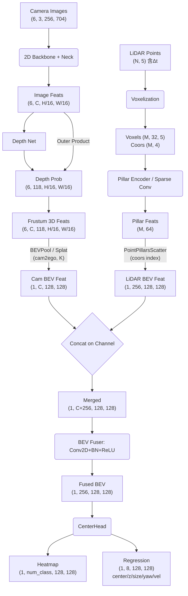

# Stage 8: Camera-LiDAR BEV Fusion 完整源码与数据流

Camera 和 LiDAR 终于在 **Ego 坐标系下的 BEV 空间**顶峰相见了。以 MIT 的 BEVFusion 为代表，多模态特征融合迎来了"大一统"。

---

## 1. 物理与几何概念：为什么在 BEV 空间融合？

| 融合空间 | 问题 | 原因 |
|---|---|---|
| 透视图（Perspective） | Camera 特征近大远小，LiDAR 是欧式空间 | 两者几何形变不一致，无法对齐 |
| 3D Voxel 空间 | Camera 单目深度缺失，特征定位不准 | 拼接会引入大量错位噪声 |
| **BEV 空间（推荐）** | 物体物理尺寸不随距离变化，无透视遮挡 | 空间对齐像素级精确，特征可直接 Concat |

**统一到 BEV 的核心优势**：在 Ego 坐标系的俯视图中，Camera BEV 和 LiDAR BEV 的每个像素格子都严格对应相同的物理空间区域（如 `0.1m × 0.1m`），使得 Concat 后的特征天然是空间对齐的。

---

## 2. 数学公式推导：Fuser 模块

两路 BEV 特征的特性完全不同：
- `BEV_cam`：特征致密（Dense），语义丰富，但定位精度受深度估计误差影响。
- `BEV_lidar`：特征稀疏（Sparse），在物体边缘有值，几何定位极度精准。

融合通过一个卷积 Fuser 进行通道聚合：

```math
BEV_{fused} = \text{Conv2D}\left(\text{Concat}(BEV_{cam},\ BEV_{lidar})\right)
```

其中：
- `Concat` 在通道维度拼接，若 `BEV_cam` 为 `(B, C_c, H, W)`，`BEV_lidar` 为 `(B, C_l, H, W)`，则拼接后为 `(B, C_c + C_l, H, W)`。
- `Conv2D` 通过 3×3 卷积 + BN + ReLU 将通道数压缩到统一维度 `C_out`。

---

## 3. 核心调用链与源码架构

典型多模态检测器（BEVFusion 架构）的 `forward` 逻辑：

**Step 1：Camera 特征提取**
```python
img_feats = self.extract_img_feat(img, img_metas)
# img → ResNet → FPN → LSS/BEVDepth → BEV_cam: (B, C_c, H, W)
```

**Step 2：LiDAR 特征提取**
```python
pts_feats = self.extract_pts_feat(points)
# pts → Voxelize → PillarEncoder → Scatter → BEV_lidar: (B, C_l, H, W)
```

**Step 3：BEV Fuser**
```python
fused_feats = self.fuser([img_feats, pts_feats])
# Concat → Conv2D(3×3) + BN + ReLU → (B, C_out, H, W)
```

**Step 4：Detection Head（CenterHead）**
```python
outs = self.pts_bbox_head(fused_feats)
# 输出: Heatmap (B, num_class, H, W) + Regression (B, 8, H, W)
```

---

## 4. 终极版张量流转大图



**各阶段知识对应关系**：
| 流程节点 | 对应 Stage |
|---|---|
| LiDAR Points 中的 `Δt` 通道 | Stage 5：时间同步与运动补偿 |
| BEVPool 时的 `cam2ego`、`K` 矩阵 | Stage 2：外参推导；Stage 4：空间对齐 |
| LiDAR/Camera 的坐标轴定义 | Stage 1：坐标系拓扑 |
| 四元数用于评估时的 Box 还原 | Stage 3：四元数 |
| PointPillarsScatter 的空间索引映射 | Stage 6：LiDAR→BEV |
| Frustum Outer Product + BEVPool | Stage 7：Camera→BEV |

---

## 5. 高频面试考点总结（大厂压轴题）

**🔥 考点 1：既然 BEVFusion 这么好，为什么工业界很多量产方案依然坚持中后融合（Late Fusion）？**

BEVFusion 是 Feature-level 的强耦合，要求 Camera 和 LiDAR 的时间戳必须强对齐。在真实车端系统中，若一路 Camera 挂掉，或 LiDAR 延迟 50ms，整个特征图拼接就会彻底错乱，导致网络输出崩溃。

而 Late Fusion（各自独立出 3D Box，在 Track 层面用卡尔曼滤波关联）具有极强的**鲁棒性（Robustness）**和**工程解耦性**：任何一个传感器失效都不影响另一路正常工作，非常适合高阶自动驾驶的安全冗余设计。

**🔥 考点 2：BEVFusion 的 Fuser 中，有没有比 Concat + Conv 更高级的融合方式？**

- **Channel/Spatial Attention（如 SE-Net, CBAM）**：利用 LiDAR BEV 特征引导 Camera BEV 的注意力权重，突出图像中的关键物体语义区域。
- **Deformable Cross-Attention**：以 LiDAR BEV 为 Query，在 Camera 图像或 BEV 特征图中自适应地搜集关键特征，缓解由 Depth 预测不准导致的 Camera BEV 特征偏移问题。
- **ConvFuser + 残差连接**：保留 LiDAR BEV 的精确几何信息，再叠加 Camera BEV 的丰富纹理语义，避免融合过程中几何特征被稀释。

---

**🎉 结语**

至此，我们完整穿透了从底层坐标系变换到顶层 BEV 融合的整条 3D 感知链路。这一套"底座"知识不仅能让你从容应对大厂面试，更是未来调优各种前沿 3D 算法的护城河！
